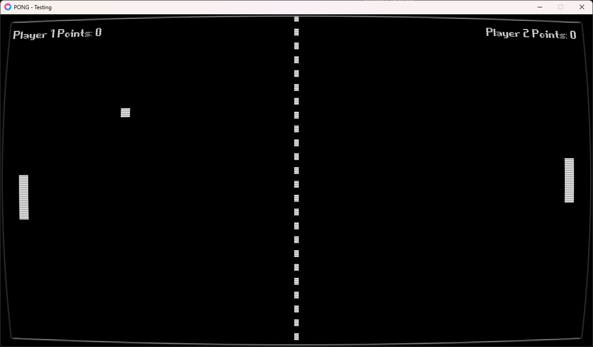

# Pong

A small, local two-player Pong game built with [LÖVE](https://love2d.org/).



## Features

- Two-player keyboard controls
- Score tracking and a winner screen
- Ball and paddle collisions
- Sound effects
- Menu handling
- Settings
- CRT and scanline visual effects

## Getting started

1. Install LÖVE from [love2d.org](https://love2d.org/).
2. From this project folder, run:

   ```sh
   love .
   ```

## Controls

| Action | Player 1 | Player 2 |
| --- | --- | --- |
| Move up | W | Up Arrow |
| Move down | S | Down Arrow |

- Press **Enter** (or **Spacebar**) when selecting a button to press it, you can also you your mouse
- Press **Escape** during a match to pause or resume.

The first player to score three points wins.
